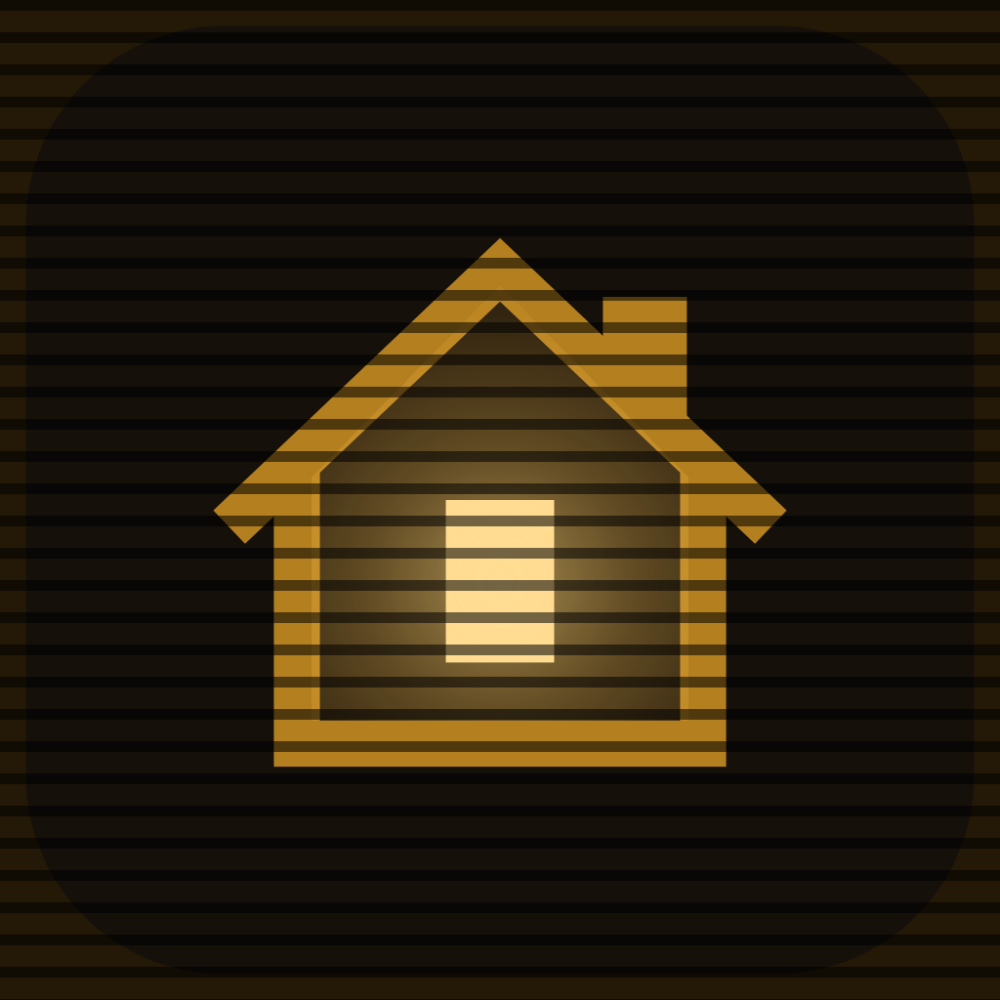

<p align="center">
  
</p>

# Someone's Home

A co-located social deduction game played in the host's real house, in the dark, in enforced
silence, with phones as the only light.

The smart home has turned. The perimeter is armed and nobody leaves. Everyone in the building is a
**Resident**; some of them are secretly also **Insiders**, blackmailed into working for the house.
It is a race between two progress bars, not a war of attrition — nobody is eliminated, access is revoked.

Residents walk to paper markers around the home and complete **Subroutines** there, driving the
**System Integrity** meter down. Reach zero and the perimeter disarms and they walk out.

Insiders shadow that loop for cover. They sabotage, they take **Override** routes Residents cannot
use, and they **Revoke** a Resident by bringing their phone to that player's phone — a physical act
at arm's length, silent and unattributed. They can also trigger an **Egress**, a house-wide crisis
that has to be contained at two markers at once or the house wins outright.

Meetings are called by walking to the meeting card and physically scanning it — never from a chair.
Every lamp snaps to white, the masking audio cuts out, every phone rings, and speech is permitted
for as long as the meeting lasts. The group talks, votes, and can **Restrain** someone. Nothing is
confirmed: no alignment is ever revealed, on removal or at the tally or at any other point. A round
runs from lobby to victory and contains many shifts of work between meetings.

## How it is actually played

Real house, lights off. One phone per player, one of them hosting. No speaking outside meetings.
The markers are QR cards printed at home and placed around the building; the host maps their own
home once in a roughly fifteen-minute setup walk, and that map is reused every round after. Don't
run, don't dodge when someone brings their phone to yours, and keep your phone held out — those are
social contract, and the app never checks any of them.

## Tech

Kotlin Multiplatform and Compose Multiplatform, iPhone first with Android on the roadmap. The game
core is server-authoritative, deterministic and replayable, and everything a client receives is
redacted per seat by a schema that fails closed. The iOS Simulator cannot run the real game — it has
no camera, BLE, torch or haptics, which is every input this game has, so anything that touches them
is only ever verified on physical devices.

## Building

```
PATH="$HOME/.local/share/mise/shims:$PATH" ./gradlew check
./run-app.sh simulator playtest
```

The simulator run is a layout-only playtest: it shows that screens lay out correctly on a
phone-shaped panel, and nothing about the game.

## Documentation

- `CLAUDE.md` — the closed vocabulary and the rules that override normal instincts here.
- `_bmad-output/project-context.md` — the implementation rules, deliberately short.
- `_bmad-output/planning-artifacts/game-architecture.md` — architecture.
- `_bmad-output/planning-artifacts/gdds/gdd-someone-is-home-2026-08-16/gdd.md` — the design.
- `.../epics.md` and `.../decision-log.md` — the work, and why anything is the way it is.

## Status

In active development. The design is still moving; the decision log is the record of what changed
and why.

## Licence

All rights reserved. This repository is public to be read, not reused: see [LICENSE](LICENSE).
